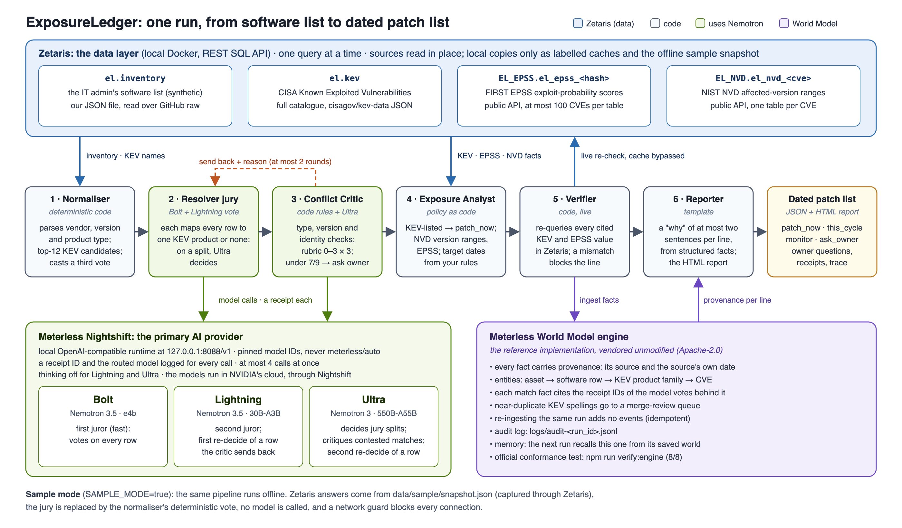

# ExposureLedger

**Agents that turn a small organisation's messy software list into a dated, evidence-backed patch list.**

ExposureLedger reads the software list of a small organisation and answers one question: *"What do I patch first, and by when?"* It matches each line of the list to the public records of exploited security flaws, decides what to do, and shows the evidence and the model receipt behind every line.

It is built for the **Solving Fragmented Intelligence** challenge: the facts it needs live in four sources that name the same software in different ways. **Zetaris** is the data layer for all four. A jury of three **NVIDIA Nemotron** models, called through **Meterless Nightshift**, does the matching. The **Meterless World Model** engine records every fact with its source.

> **Decision support only.** The patch policy is the user's own and is configurable. ExposureLedger makes no claim that a flaw is exploitable on your systems. The inventory in this repository is synthetic. KEV due dates are US federal deadlines, shown as a benchmark.

**At a glance:** 0 wrong answers on 30 held-out rows (one run): 23 of 23 answered rows right; 7 sent to the owner with a question instead of a decision. The rows come from the synthetic inventory and the answers from two teammates. In the same test, a single Ultra call, given all 30 rows and the union of our normaliser's candidate shortlists, named the right KEV product (or none) for all 30. Details: [§11](#11-evaluation) and [`docs/evaluation.md`](docs/evaluation.md).

## Team

**Megatron's Interns**, for the GenAI.works Open Agent Hackathon 2026, track **Solving Fragmented Intelligence**.

| Name | GitHub | Role |
|---|---|---|
| Mohd Amir Suhel (team lead) | [`Amir-007`](https://github.com/Amir-007) | test answers, fresh-download test, slide deck, demo video, submission |
| Thant Zaw Latt | [`Z-a-w-L-a-t-t`](https://github.com/Z-a-w-L-a-t-t) | the synthetic software list, test answers |
| Berkin Kaynar | [`berkinksk`](https://github.com/berkinksk) | system design and code (built with Claude Code), data setup |

**Slide deck:** [`docs/deck.pdf`](docs/deck.pdf) · **Fresh-download test on a second computer:** [`docs/fresh-download-test/`](docs/fresh-download-test/)

---

## Contents
1. [The problem and the user](#1-the-problem-and-the-user)
2. [What it does](#2-what-it-does)
3. [Architecture](#3-architecture)
4. [The agents and how they work together](#4-the-agents-and-how-they-work-together)
5. [Sponsor technology: Zetaris, Meterless and NVIDIA](#5-sponsor-technology-zetaris-meterless-and-nvidia)
6. [Setup](#6-setup)
7. [Usage: CLI, HTTP API, report](#7-usage-cli-http-api-report)
8. [Sample mode (offline)](#8-sample-mode-offline)
9. [Logs and evidence](#9-logs-and-evidence)
10. [Input and output examples](#10-input-and-output-examples)
11. [Evaluation](#11-evaluation)
12. [Tests and checks](#12-tests-and-checks)
13. [Configuration](#13-configuration)
14. [Data sources](#14-data-sources)
15. [AI and Model Usage](#15-ai-and-model-usage)
16. [Third-Party Code and Licences](#16-third-party-code-and-licences)
17. [Limitations](#17-limitations)
18. [Security caveats](#18-security-caveats)
19. [Future work](#19-future-work)

---

## 1. The problem and the user

**The user** is the only IT administrator at a charity of about 200 people. Every week, new flaws are added to the list of those already exploited by attackers, and there is no security team to triage them.

**The question:** *"Of everything we run, what do I patch first, and by when?"*

**Why this is hard.** The answer is spread across four sources, and each one names software differently:

| Source | What it says | How it names software |
|---|---|---|
| The organisation's software list | what runs where | free text: `MS Exchange Svr 2019 CU12`, `Citrix netscaler ADC / Gateway; firmware tbc` |
| CISA KEV (Known Exploited Vulnerabilities) | flaws exploited in the wild, with a due date | vendor + product, e.g. `Microsoft / Exchange Server`; KEV alone spells Citrix's gateway 7 ways |
| FIRST EPSS | the probability that a flaw is exploited in the next 30 days | CVE ID only |
| NIST NVD | which product versions a flaw affects | CVE ID + CPE version ranges |

Look-alikes make it worse. In our first probe (26 Oct, 10 strings), all three Nemotron models, Ultra included, matched "Exchange Online" to the on-premises Exchange Server and "FortiClient VPN" to the FortiClient EMS management server. In the final test (§11), Bolt alone and Lightning alone named a KEV product for 4 and 6 of the 12 rows that have none (both matched "Exchange Online" to the on-premises Exchange); the full system answered none of the 12 with a KEV product.

## 2. What it does

- **Input:** the software list, as rows (only the `software` text is required). The rows come from the inventory registered in Zetaris, or from the request.
- **Output:** a **dated patch list**. Each line has:
  - a **decision**: `patch_now`, `this_cycle`, `monitor` or `ask_owner`;
  - a **target date** from your rules (7 days for `patch_now` by default), plus the KEV federal due date as a benchmark ("passed N days ago");
  - the **evidence**: the KEV entries, EPSS scores and NVD version ranges it used, each with its source, query and date. A KEV CVE whose NVD ranges place the installed version outside is not cited (it is listed apart as "version not affected"). The CVEs NVD places the version inside lead the line, and the ones NVD could not check stay cited, labelled "not version-checked, counted fail-closed": the due date, the "overdue" days and the EPSS come from both, so more evidence never makes a line less urgent;
  - the **critic's verdict** and rubric score, and whether the **verifier** re-checked the line live;
  - the **receipts** of every model call behind the match;
  - a short **"why"**, written from those facts only;
  - for `ask_owner` lines, and for lines whose version could not be confirmed, a concrete **question for the owner** ("Which Connect Secure version runs on remote-01?").
- Every run also writes an **HTML report** and a **trace** of every agent step.

A real line from [`output_examples/example_1.json`](output_examples/example_1.json):

```text
R73  patch_now  target 2026-11-03  erp-portal-01 (internet-facing)  "Apache Tomcat v9.0.54 - ERP app" -> Apache / Tomcat
why: NVD places Apache Tomcat 9.0.54 inside the affected range of CVE-2025-24813, which CISA KEV lists as exploited
     in the wild (added 2025-04-01); it is outside the ranges of 5 other KEV CVEs. Patch by 2026-11-03 under your
     7-day rule; the US federal due date (2025-04-22) passed 553 days ago, and EPSS for CVE-2025-24813 is 0.99942.
votes: Bolt, Lightning and the normaliser agree (receipts rcpt_req_oj3cxr4j, rcpt_req_juzzifxr) · critic 9/9 · re-checked live
```
(KEV lists 6 Tomcat CVEs. NVD places 9.0.54 outside the ranges of the other 5, the newer CVE-2026-34486 and four older ones such as Ghostcat, CVE-2020-1938, so they are not cited: they are listed in the line's evidence as "version not affected". A CVE NVD cannot check stays cited and counts toward the date, labelled "not version-checked, counted fail-closed". In the same run, "Apache HTTPD 2.4.49" cites three CVEs NVD confirms, including CVE-2021-41773, so its US federal due date is 2021-11-17, 1,805 days ago.)

## 3. Architecture



(Source: [`docs/architecture.svg`](docs/architecture.svg). The full design is in [`docs/design.md`](docs/design.md).)

One run, step by step (`src/run.ts`):

1. **Discovery and inventory:** the run lists the sources registered in Zetaris (`SHOW LIGHTNING DATABASES`, `SHOW LIGHTNING TABLES`, each REST table with its endpoint), then reads the request's rows or the `el.inventory` view.
2. **KEV names:** the distinct (vendor, product) pairs of the KEV catalogue, through Zetaris.
3. **Normaliser** (code): parses each row, guesses its product type, picks the 12 most likely KEV products and casts a deterministic vote.
4. **Resolver jury:** Bolt and Lightning vote on every row in batches of 10, in parallel. When they disagree, Ultra decides. At the same time, the fact store prefetches KEV entries, EPSS scores and NVD records through Zetaris (one query at a time).
5. **Conflict Critic loop:** code rules on every row, Ultra on contested matches, send-backs to the resolver (at most 2 rounds), then `ask_owner`.
6. **Exposure Analyst:** the user's policy as code turns the matches and facts into decisions and dates. Then **one federated SQL inside Zetaris** joins the run's rows with the whole KEV catalogue the naive way (the KEV product name inside the software text), and the trace and report set its hits against the agents' answers (display only; it never decides a line).
7. **Verifier:** re-queries every cited KEV entry and EPSS score live in Zetaris, cache bypassed. A mismatch blocks the line.
8. **World Model:** each row's last earlier live run is reopened from its saved world ("since the last run"); this run's facts are ingested with provenance; each line gets its provenance block; the audit log is written.
9. **Outputs:** `output/run-<id>.json`, `output/report-<id>.html`, `logs/trace-<id>.jsonl` (the trace is also printed to stdout).

## 4. The agents and how they work together

| # | Agent | Kind | What it does | Hands off to |
|---|---|---|---|---|
| 1 | **Normaliser** (`src/resolve/normalise.ts`) | deterministic code | Parses vendor, version and product type (server, network appliance, client, cloud service, library, OS). Builds the top-12 KEV candidates per row. Casts the "third vote". | Resolver jury |
| 2 | **Resolver jury** (`src/agents/jury.ts`) | Nemotron Bolt + Lightning, Ultra on splits | Each juror maps every row to one KEV product or "none". If they agree, the answer stands. If they split, Ultra adjudicates and gives its reason. A row the critic sends back is re-decided: first by Lightning, then by Ultra. | Critic |
| 3 | **Conflict Critic** (`src/agents/critic.ts`, `src/pipeline/critic-loop.ts`) | code rules + Ultra | Blocks product-type conflicts (cloud vs on-premises, client vs server, OS vs application), name-only matches without version evidence, and matches without provenance. Scores a **0–3 rubric on accuracy, appropriateness and actionability**. **Below 7/9, the line goes to the owner (autonomy level L1); otherwise it is automatic (L2).** Ultra critiques contested matches; its objections block the match until the answer changes. Sends work back with the reason, **at most 2 rounds**. | Resolver (send back) or Analyst |
| 4 | **Exposure Analyst** (`src/policy/analyst.ts`) | policy as code | KEV-listed and affecting the installed version → `patch_now`, citing every KEV CVE that NVD's ranges do not rule out (confirmed first, the unchecked ones counted fail-closed). Outside every NVD range → `monitor`. Unresolved, disputed, or under 7/9 → `ask_owner`. Sets the target dates. | Verifier |
| 5 | **Verifier** (`src/agents/verifier.ts`) | code, live | Re-reads every cited KEV entry and EPSS score with fresh, single-source Zetaris queries. A mismatch blocks the line (`verified: false`, with a note). A line that cites no KEV or EPSS value (a "no KEV product" line) has nothing to re-check, and is counted apart, never as re-checked. | Reporter |
| 6 | **Reporter** (`src/agents/reporter.ts`, `src/report/`) | template | Writes the "why" (at most two sentences) from the line's structured facts. Renders the HTML report. | output |

**Collaboration you can see in a real trace** ([`output_examples/example_1.trace.jsonl`](output_examples/example_1.trace.jsonl), 12 rows, live):

```text
zetaris          discovery          sources discovered: 4 database(s) (EL_EPSS, EL_INVENTORY, EL_KEV, EL_NVD); ...
resolver_jury    split_detected     batch 1: 2 split row(s) sent to Ultra · batch 2: 1 split row(s) sent to Ultra
jury.adjudicate  ultra_adjudication 3 of 3 decided    model=nvidia/nemotron-3-ultra-550b-a55b receipt=rcpt_req_n06lqy7s
                   R71 "Veeam Agent for Microsoft Windows 6.1": Ultra sided with Bolt -> none ("a distinct endpoint
                   backup agent; Veeam Backup & Replication is the management server product")
critic           send_back          R20 "Microsoft Word Online (browser app)" -> Microsoft / Word: type conflict:
                                    cloud service vs on-prem client software (rubric 5/9)
critic           send_back          R73 Apache Tomcat 9.0.54: name-only match, no version evidence -> NVD ranges fetched
resolver.retry.lightning redecide   0 of 1 changed their answer   model=nvidia/nemotron-3.5-lightning-30b-a3b
resolver.retry.ultra     redecide   0 of 1 changed their answer   model=nvidia/nemotron-3-ultra-550b-a55b
critic           ask_owner          R20 Word Online: type conflict still failing after 2 send-backs: ask the owner (L1)
critic           version_check_completed  24 looked up in NVD: 5 now inside, 19 now outside (dropped on evidence)
zetaris          naive_join         a plain SQL join of the inventory and KEV inside Zetaris hits 9 of 12 rows: 5 agree
                                    with the agents, 2 are look-alikes, 1 names another product; the agents resolve 3 it misses
verifier         recheck            9 re-checked and matched, 3 with nothing to re-check, 0 blocked (of 12)
world_model      ingest_run         +1582 engine events; 0 warnings
```

(Abridged from the trace's `agent`, `action` and `output_summary` fields. Each line of the file is one full JSON event.)

**Policy (the user's rules, `config/policy.json`, overridable per run):**
1. **`patch_now`:** the installed version is affected by a CVE listed in KEV, whatever its EPSS score. The report shows where KEV and EPSS disagree. The line drops only the KEV CVEs NVD places the version outside. It leads with the ones NVD places it inside and keeps the ones not version-checked, counted fail-closed, so its due date, "overdue" days, EPSS and sort order rest on every CVE that may apply and never on one that does not. Once NVD confirms one CVE, the line's other cited CVEs are looked up too, within the run's NVD budget (most urgent first), so an older CVE is dropped only on NVD's evidence. When the version cannot be confirmed (no version in the row, or NVD gives no range for it) but the match itself scores at least 7/9, the line stays `patch_now` (fail-closed), is flagged "version unconfirmed", and carries the owner question. A weaker match goes to `ask_owner`.
2. **`this_cycle`:** a CVE *not* in KEV affects the version, with EPSS ≥ 0.10 (≥ 0.05 if internet-facing). **This bucket is empty in this build:** finding non-KEV CVEs needs the NVD product lookup, which is not switched on (it is listed as dormant in every run's manifest).
3. **`monitor`:** no KEV product matches, or NVD places the installed version outside every cited KEV CVE's ranges. Next review in 90 days.
4. **`ask_owner`:** unresolved, a type or identity conflict that survives the retries, or a rubric score under 7/9. Each comes with a concrete question.
5. **Fail-closed:** if KEV or EPSS cannot be read live, nothing is relaxed to `monitor`. That includes a read that Zetaris could only answer from the client's saved copy: the copy is labelled not live (manifest and evidence), the run is `partial`, and a line that would be `monitor` goes to the owner instead.
6. **Windows rows without a build number** that pass the critic stay `patch_now` ("install the latest cumulative update"), and the owner gets one question per Windows edition.
7. **Sort order:** decision → internet-facing first → most overdue KEV due date → highest EPSS.
8. **Memory:** a line that an earlier live run already listed as `patch_now` for the same product keeps that run's target date (the World Model recalls it from that run's saved world), so re-running the list every day never pushes a deadline back. Memory is kept per row (its id, asset and software text): a run on a subset of the rows (`--rows`, `row_ids`) moves only those rows' pointers, so it never resets the clock of the rows it left out.

## 5. Sponsor technology: Zetaris, Meterless and NVIDIA

### Zetaris: the data layer
In live mode, every fact the agents use comes through Zetaris's REST SQL API (`POST /sql-editor/sqls/run` on the local Zetaris in Docker). The agents never see SQL: they call named queries (`src/adapters/queries.ts`), which run one at a time through a serial queue (`src/adapters/zetaris.ts`).

`npm run setup` (`scripts/setup.ts`) registers the sources from an empty Zetaris. It is idempotent and never drops anything:

| Zetaris object | What it reads | Created by |
|---|---|---|
| `EL_INVENTORY.el_inventory_raw` + view `el.inventory` | our synthetic inventory JSON, over GitHub raw | setup |
| `EL_KEV.el_kev_raw` + view `el.kev` | the full CISA KEV catalogue (`cisagov/kev-data` JSON) | setup |
| `EL_EPSS.el_epss_<hash>` | the FIRST EPSS API, one REST table per batch of at most 100 CVEs | each run, as needed |
| `EL_NVD.el_nvd_<cve>` | the NIST NVD CVE API, one REST table per CVE | each run, as needed |

The registration pattern, as `scripts/setup.ts` sends it:

```sql
CREATE LIGHTNING DATABASE EL_KEV DESCRIBE BY "CISA KEV catalogue JSON read over GitHub raw";
CREATE LIGHTNING REST TABLE el_kev_raw FROM EL_KEV REQUEST(endpoint "https://raw.githubusercontent.com/cisagov/kev-data/main/known_exploited_vulnerabilities.json", method "get", response_type "json", http_encoding "URLENCODED") HEADER () BODY ();
CREATE SCHEMASTORE CONTAINER el;
CREATE SCHEMASTORE VIEW kev WITH CONTAINER el AS SELECT v.cveID AS cve_id, v.vendorProject AS vendor, v.product AS product, ... FROM el_kev.el_kev_raw LATERAL VIEW explode(vulnerabilities) AS v;
```

(`...` stands for the other KEV columns; run `npm run setup -- --dry-run` to print every statement in full.)

**What Zetaris does in a run:** it lists the registered sources (discovery), reads the inventory and the KEV names, then the KEV entries for the matched products, the EPSS scores and the NVD records. The verifier then re-reads every cited value with single-source queries. The 12-row example ran 13 queries and 2 table registrations through Zetaris. Every query is in the trace with its SQL, row count and time.

**One federated SQL, shown in every live run** (`naiveJoin` in `src/adapters/queries.ts`; the report's "One SQL across the inventory and KEV" panel):

```sql
SELECT i.row_id, k.vendor, k.product, count(DISTINCT k.cve_id) AS kev_cves
FROM el.inventory i JOIN el.kev k ON instr(lower(i.software), lower(trim(k.product))) > 0
WHERE i.row_id IN (...) GROUP BY i.row_id, k.vendor, k.product
```

It joins our synthetic inventory (a REST table over GitHub raw) with the whole CISA KEV catalogue (a REST table over CISA's JSON) inside Zetaris, in about 0.7–1.9 s. A request's own rows go in as an inline `VALUES` table. On example 1 it hits 9 of 12 rows: 5 agree with the agents; 2 are look-alikes the agents rejected ("Desktop" inside "PowerToys … desktop utilities", "Windows" inside "Veeam Agent for Microsoft Windows"); 1 ("Word" inside "Word Online") is a look-alike the critic sent to the owner; 1 names another product; and it misses 3 rows the agents resolve (Ivanti "ConnectSecure", Cisco "Secure Email GW", "PaperCut NG"). That gap is the reason for the agents. The join is evidence and display only: it never decides a line.

**Query rules:** one query at a time; a 60 s timeout per attempt and a 120 s watchdog; values are parsed from strings. Results are saved to a local disk cache (`output/cache/zetaris/`): if a live read fails, the last saved copy is served, and the run says so everywhere: `fallback` in the trace, `live: false` with the copy's date in the manifest and the evidence, a `partial` run, and no line relaxed to `monitor` on it. The verifier never uses that cache.

### Meterless World Model engine
- **What it is:** the Meterless World Model reference engine, vendored unmodified in [`src/engine/world-model/`](src/engine/world-model/) (Apache-2.0). Our wrapper is [`src/engine/index.ts`](src/engine/index.ts).
- **The features it powers:** the provenance of every patch line, and memory across runs (below). Each run ingests its entities (asset, software row, KEV product family, CVE) and facts (`runs`, `internet_facing`, `resolves_to`, `kev_listing`, `affects`, `epss`, `decision`). Every fact carries its source (`zetaris:el.kev`, `zetaris:epss`, `agent:jury`, … ; `snapshot:…` in sample mode) and the source's own date (the KEV catalogue version, the EPSS score date, the run's as-of date), never the wall clock. `resolves_to` facts cite the receipt IDs of the model votes.
- `explain()` gives each line its provenance block in the report. Near-duplicate KEV spellings go to the engine's merge-review queue (never auto-merged). `audit()` writes `logs/audit-<run_id>.jsonl`. The world is saved to `output/world/`.
- **Memory across runs** (`src/pipeline/memory.ts`): for each row, the next live run reopens the saved world of the last run that included that row, read-only (the engine replays its events), and asks it, with `factsAsOf`, what it believed about the row. The trace and the report's "Since the last run" panel list the decisions that changed, the KEV CVEs cited now that were not cited then (and which KEV added after that run), and the owner questions still open; a line that was already `patch_now` keeps the earlier target date. The index (`output/world/last-runs.json`) maps each row (its source, id, asset and software text) to its last run: a pointer only. A run on another subset of the rows never resets the rows it left out; a row whose software text changes starts a new clock.
- **The test:** `npm run verify:engine` runs the engine's **official conformance runner (8/8)** against the vendored code, its idempotency check ("diff: empty"), the same check with `--mutate` (which must say "diff: NON-EMPTY", to prove the check can fail), and a SHA-256 check that the vendored files are unmodified.

```text
$ npm run verify:engine
  PASS vendored files unmodified: 10/10 files match
  PASS conformance runner: 8/8 checks passed, exit 0
  PASS idempotency check: diff: empty, exit 0
  PASS idempotency check can fail (--mutate): diff: NON-EMPTY, exit 0
verify:engine OK: 4/4 engine checks passed
```

### Meterless Nightshift: the primary AI provider
Every model call goes through Nightshift's local OpenAI-compatible endpoint (`POST {METERLESS_BASE_URL}/chat/completions`, `src/adapters/nightshift.ts`). There is no other AI provider in the code.
- Headers: `Authorization: Bearer $METERLESS_RUNTIME_TOKEN`, `meterless-app: exposureledger`, `meterless-scope: user`.
- **Pinned model IDs only, never `meterless/auto`.** Temperature 0. Lightning and Ultra are always sent `chat_template_kwargs: {"enable_thinking": false}`, and JSON mode when a JSON reply is wanted.
- At most 4 calls at once; a 90 s timeout per attempt; up to 2 retries on 429, 5xx or network errors.
- **A receipt for every call:** the trace and `RunResponse.receipts` record the requested model, `response.model`, Nightshift's `routed_model` and `receipt_id`, the latency and the tokens. `npm run verify` checks that every model call in the newest live trace has a receipt and a pinned routed model.
- If a call still fails, that row falls back to the normaliser's deterministic vote (traced as `fallback`), and the run is marked `partial`.

### NVIDIA Nemotron: three model sizes, three roles
| Model (pinned ID) | Role |
|---|---|
| **Bolt** `nvidia/nemotron-3.5-bolt-e4b` | first juror: votes on every row |
| **Lightning** `nvidia/nemotron-3.5-lightning-30b-a3b` | second juror; makes the first re-decide of a row the critic sends back |
| **Ultra** `nvidia/nemotron-3-ultra-550b-a55b` | decides jury splits; critiques contested matches; a "same product?" check before an unconfirmed `patch_now` that the normaliser does not back; the second re-decide of a row |

The models run in NVIDIA's cloud, reached through Nightshift. The receipts show which model answered each call. In the three examples, all 15 calls (9 + 2 + 4) were answered by the pinned model that was asked for.

## 6. Setup

**Requirements**
- **Node.js 25 or newer.** Nothing to install: zero runtime dependencies, and TypeScript runs directly with `node --experimental-transform-types` (the npm scripts pass the flags).
- **For live mode:**
  - Zetaris running locally in Docker (REST API at `http://localhost:8888/api/v1.0`), with an API key and org ID;
  - the Meterless Nightshift app open (`http://127.0.0.1:8088/v1`), with your NVIDIA API key in its Providers tab and a runtime token from its Console.
  - **How to install them:** follow the organisers' *Participant Setup Guide* (HackOS Resource Center): Zetaris in "Data" §1.1–1.9, Nightshift and the NVIDIA provider in "Power" §4.2–4.6. Public references: Zetaris's getting-started instructions (https://github.com/zetaris/getting-started/blob/main/README.md) and the Nightshift download (the install cards at the bottom of https://meterless.ai).
- **For sample mode:** nothing else. No Zetaris, no Nightshift, no network.
- Docker is optional (§7).

**From a clean clone**
```bash
git clone https://github.com/berkinksk/Open-Agent-Hackathon-2026.git
cd Open-Agent-Hackathon-2026
cp .env.example .env    # then fill in ZETARIS_API_KEY and METERLESS_RUNTIME_TOKEN (and ZETARIS_ORG_ID if not 1)
npm run setup           # registers the Zetaris sources (idempotent; safe to re-run)
npm run verify          # one-command check: env, Zetaris, Nightshift, views, engine, tests, receipts
```

To try it with no services at all, skip `.env` and go to [§8 Sample mode](#8-sample-mode-offline).

**More setup options**
```bash
npm run setup -- --dry-run          # print the SQL without sending it
npm run setup -- --prefix EL_T1_    # the same objects under a fresh prefix (proves setup from empty)
npm run verify -- --skip tests      # the live checks only
```

## 7. Usage: CLI, HTTP API, report

There is no `run.py` (this is a Node.js app): the entry points are `npm start` (the HTTP API, `POST /run`) and `npm run cli` (one run from the command line).

**Command line**
```bash
npm run cli -- --input input_examples/example_1.json            # one live run
npm run cli -- --input input_examples/example_2.json --sample   # the same pipeline, offline
npm run cli -- --rows R05,R12,R20                               # chosen rows of the inventory registered in Zetaris
npm run cli -- --help
```
The CLI prints the trace, then the decision counts and the output paths:
```text
run example-1  mode=live  status=success  as_of=2026-10-27  30.3 s
  patch_now   7
  this_cycle  0
  monitor     3
  ask_owner   2
  owner questions: 5   model calls: 9   lines: 12
outputs:
  run     output/run-example-1.json
  report  output/report-example-1.html
  trace   logs/trace-example-1.jsonl
```

**Timing:** the first live run of the day (or the first on a fresh clone) takes about 1–1.5 minutes (65–87 s measured), because cold NVD lookups are slow and a run may spend up to its 60 s NVD budget (`EL_NVD_BUDGET_S`). NVD records are cached per CVE for the day: a run whose CVEs are already cached takes about 20–30 s (the runs in §10), while a run on rows with new CVEs is slow again.

**HTTP API** (`npm start`, on `0.0.0.0:8000`; set `PORT` to change it)
```bash
npm start
```
In a second terminal:
```bash
curl -s localhost:8000/health
curl -s -X POST localhost:8000/run -H 'Content-Type: application/json' -d @input_examples/example_1.json > response.json
# then open http://localhost:8000/report/<run_id> in a browser (the run_id is in response.json)
```

| Endpoint | What it does |
|---|---|
| `POST /run` | body: a `RunRequest`; returns a `RunResponse` (JSON). Runs are processed one at a time. |
| `GET /report/:run_id` | the HTML report of a run |
| `GET /health` | liveness, the mode, and which settings are missing (names only) |

**`RunRequest`** (all fields optional; types in [`src/contracts.ts`](src/contracts.ts)). Your own rows:
```json
{
  "run_id": "my-run-1",
  "inventory": [ { "row_id": "J01", "asset_name": "webmail-01", "internet_facing": true, "software": "Zimbra Collaboration Suite 8.8.15" } ],
  "sample_mode": false,
  "policy": { "sla_days": { "patch_now": 3 } }
}
```
or chosen rows of the inventory registered in Zetaris: `{"row_ids": ["R05", "R12"]}`.
- Each inventory row needs only `software`. The other fields (`row_id`, `asset_id`, `asset_name`, `asset_type`, `internet_facing`, `owner_team`) get neutral defaults. A bare JSON array is read as the inventory.
- Without `inventory`, the run reads `el.inventory` through Zetaris. `row_ids` picks rows from whichever inventory is used.
- At most 200 rows per run. Through the HTTP API, a run that takes more than 10 minutes returns HTTP 504.

**`RunResponse`:** `run_id`, `mode` (`live` or `sample`), `status` (`success`, `partial` or `error`), `as_of`, `timing_ms`, `summary` (count per decision), `lines` (the patch list), `owner_questions`, `receipts`, `trace_file`, `report_file`, and `manifest` (the engine; every source with its date and its `live` flag, which is true only when this run read that source live through Zetaris; the pinned models; the helpers that ran and the ones that are dormant; the policy).

**Errors** are structured: `{"status": "error", "error": {"type", "message", "recoverable"}}` with HTTP 400 (bad request), 413 (body over 2 MB), 503 (settings missing) or 504 (run timeout).

**The report** (`output/report-<run_id>.html`, or `GET /report/:run_id`) is one self-contained page with no scripts: the patch list, the evidence and provenance of each line, the owner questions, the plain SQL join set against the agents, what changed since the last run, the jury splits decided by Ultra, the critic's catches, the receipts table, the Zetaris queries and the timing.

**Docker**
```bash
docker build -t exposureledger .
cp .env.docker.example .env.docker      # fill in the credentials; it uses host.docker.internal
docker run --rm --env-file .env.docker exposureledger npm run setup   # once, on a new Zetaris: registers el.inventory and el.kev
mkdir -p logs output
docker run --rm -p 8000:8000 --env-file .env.docker -v "$PWD/logs:/app/logs" -v "$PWD/output:/app/output" exposureledger
```
- **Inside Docker, use the `host.docker.internal` URLs from `.env.docker.example`, not `localhost` or `127.0.0.1`:** inside a container, both point to the container itself, so Zetaris and Nightshift cannot be reached. If you copied `.env.example` instead, set `ZETARIS_REST_URL=http://host.docker.internal:8888/api/v1.0` and `METERLESS_BASE_URL=http://host.docker.internal:8088/v1` in it.
- `npm run setup` is idempotent and never drops anything. Without it, a Zetaris that has never seen this app has no `el.inventory` or `el.kev`: a `row_ids` request returns `inventory_unavailable`, and rows of your own fail closed to `ask_owner`.
- Offline: `docker run --rm -p 8000:8000 -e SAMPLE_MODE=true exposureledger`.
- The `-v` mounts keep the traces and reports on the host after `--rm`. Without them, the full trace is still on the container's stdout: `docker logs <container>` (run without `--rm`, or with `-d`, to read it afterwards). (Tested on macOS Docker Desktop. On Linux, the container's `node` user, uid 1000, must be able to write to the two folders.)
- On Linux without Docker Desktop, add `--add-host=host.docker.internal:host-gateway`.
- The image installs nothing and holds no secrets: credentials are passed only when the container runs.

## 8. Sample mode (offline)

```bash
SAMPLE_MODE=true npm run cli -- --input input_examples/example_1.json
npm run cli -- --input input_examples/example_2.json --sample
SAMPLE_MODE=true npm start
```

- **What it is:** the same pipeline, with no `.env`, no Zetaris, no Nightshift and no network. A network guard (`src/sample/guard.ts`) makes `fetch` and every socket connection fail for the whole run, and a test proves that no socket opens.
- **Data:** the named queries are served from [`data/sample/snapshot.json`](data/sample/snapshot.json), real data captured through Zetaris by `npm run snapshot` on 27 Oct 2026: the 80-row synthetic inventory, the full KEV catalogue (version 2026.10.23, 1,756 entries), EPSS for every KEV CVE (scores of 2026-10-26) and 29 NVD records. It holds input data only: no model replies and no decisions.
- **What still runs for real:** the normaliser, the critic's rules, the policy, the verifier (against the snapshot, labelled as such), the World Model and the report.
- **What is off:** every model. The jury is replaced by the normaliser's deterministic vote, and Ultra's critiques are skipped. Nothing recorded from a model is ever replayed.
- **Labelling:** every output says `"mode": "sample"`, the manifest lists the snapshot with its capture date, and the report shows a SAMPLE MODE banner.
- **What to expect:** sample mode is more cautious and also weaker than live mode. Without the jury, more lines go to `ask_owner`: the three inputs give 3 / 0 / 3 / 6, 0 / 0 / 0 / 6 and 0 / 0 / 1 / 5 offline (patch_now / this_cycle / monitor / ask_owner). For example, "WordPress 6.4.3" names KEV's vendor `WordPress`, whose KEV product is only the generic word `Core`: offline, the normaliser casts an unsure vote and the row goes to the owner, never to `monitor`; live, the jury matches `WordPress / Core` and NVD confirms the version. Use live mode for real decisions.
- To refresh the snapshot (needs live Zetaris, about 5 minutes): `npm run snapshot`.

## 9. Logs and evidence

- **The trace:** `logs/trace-<run_id>.jsonl`, one JSON event per step, also printed to stdout as `[INFO] run_id=… <agent> <action> <status> | <summary>`.
- **Fields** (`TraceEvent` in `src/contracts.ts`): `ts`, `run_id`, `agent`, `action`, `input_summary`, `output_summary`, `target_agent`, `model`, `routed_model`, `receipt_id`, `latency_ms`, `confidence`, `retry_count`, `status` (`ok`, `error`, `fallback`, `blocked`, `sent_back`), and `details`. Each event also carries `timestamp` and `agent_name`, the names the organisers' guide recommends.
- **What the trace shows:** every agent and handoff; every model call with its model, routed model, receipt and tokens; the jury splits and Ultra's decisions; the critic's send-backs, retries and owner questions; every Zetaris query with its SQL, row count and time; NVD lookups; the verifier's re-check; the World Model's ingest; fallbacks and errors.
- **The World Model audit log:** `logs/audit-<run_id>.jsonl`.
- **NVD counts** in the run summary (`agents_summary.details.nvd`): `live_reads` (CVEs read through Zetaris in this run, always 0 in sample mode), `attempts` (the per-run budget counter), `errors`, `fallback`, `cached` (today's cache) and `skipped`.
- **Never logged:** secret values. The tracer masks the configured credentials.
- Three real traces are in [`output_examples/`](output_examples/) (`output_examples/example_N.trace.jsonl`), so a fresh clone has real traces to read before its first run. Your own runs add `logs/trace-<run_id>.jsonl` and `logs/audit-<run_id>.jsonl` (`logs/` is not committed).

## 10. Input and output examples

The three outputs are **real runs**, made live (Zetaris + Nightshift) with `npm run cli -- --input input_examples/example_N.json --run-id example-N` on 27 Oct 2026, 15:06–15:08 UK, with that day's NVD records already in the per-day cache (earlier runs that morning had read them; the manifests label them cached, not live). They are never read by the app. The only change after the run: local absolute file paths were shortened to repo-relative ones (details in [`output_examples/README.md`](output_examples/README.md)).

"Re-checked" counts the lines whose cited KEV and EPSS values the verifier compared with fresh Zetaris reads. A line that cites none (a "no KEV product" line) has nothing to re-check and is counted apart.

All three inputs are synthetic: example 1 picks rows of the synthetic inventory; examples 2 and 3 are rows we made up.

| Input | What it shows | Result (live) |
|---|---|---|
| [`example_1.json`](input_examples/example_1.json): 12 rows of the registered inventory, by `row_ids` | the inventory read through Zetaris; discovery and the plain SQL join (9 of 12 hit, 3 of them look-alikes); jury splits decided by Ultra (Veeam Agent is not Veeam Backup & Replication; a Windows Server "mail host" is Windows, not Exchange Server; after the split and with no build number it scores 6/9 and goes to the owner); the critic catching a cloud look-alike (Word Online, sent to the owner after two re-decides); lines whose cited KEV CVEs follow NVD's per-CVE check (Tomcat and Exchange drop the CVEs NVD rules out; HTTP Server 2.4.49 keeps CVE-2021-41773, due 2021-11-17); fail-closed `patch_now` with version questions | 30.3 s · 7 patch_now / 0 this_cycle / 3 monitor / 2 ask_owner · 9 model calls (Bolt 2, Lightning 3, Ultra 4) · 9 re-checked + 3 with nothing to re-check |
| [`example_2.json`](input_examples/example_2.json): 6 made-up rows (not in the bundled inventory), with all fields | rows that are not in the bundled inventory, joined in Zetaris as an inline `VALUES` table; a one-letter look-alike (OpenSSH, not OpenSSL) → no KEV product; KEV and EPSS disagreeing (Notepad++: KEV-listed, EPSS 0.018) | 24.0 s · 5 / 0 / 1 / 0 · 2 model calls · 5 re-checked + 1 with nothing to re-check |
| [`example_3.json`](input_examples/example_3.json): 6 made-up rows with only `software`, plus a policy override (`patch_now` within 3 days) | the minimal input; 2026 KEV entries (WordPress, Roundcube, MikroTik RouterOS, SolarWinds Web Help Desk); a cloud look-alike (SharePoint Online) sent back and corrected | 19.6 s · 4 / 0 / 2 / 0 · 4 model calls (Ultra 1) · 4 re-checked + 2 with nothing to re-check |

Each output has three files: `example_N.json` (the `RunResponse`), `example_N.trace.jsonl` (the trace) and `example_N.report.html` (the report). Inside `example_N.json`, the `trace_file` and `report_file` fields keep the paths the run wrote (`logs/trace-example-N.jsonl`, `output/report-example-N.html`); the committed copies of those two files are `output_examples/example_N.trace.jsonl` and `output_examples/example_N.report.html`.

Model answers can differ slightly between identical runs (see §11), so a new run of the same input may not match these files line for line.

## 11. Evaluation

**Final test: 0 wrong answers on 30 held-out rows (one run): 23 of 23 answered rows right; 7 sent to the owner with a question instead of a decision.** The full write-up, with every owner row explained, is in [`docs/evaluation.md`](docs/evaluation.md); the run's files are in [`docs/eval/final-test/`](docs/eval/final-test/).

- **Rows:** 30 rows picked at random from the 80-row synthetic inventory (the seed is the list's SHA-256; [`data/eval/test_rows.json`](data/eval/test_rows.json)) and sealed during development.
- **Answers:** written independently by two teammates; where they differed, one of their two answers was chosen per row, following the labelling rules ([`data/test_answers.csv`](data/test_answers.csv)).
- **Scoring:** by KEV product family. *Strict* counts every row left to the owner as not answered.
- **One run,** live, on 27 Oct 2026 at 15:26 UK, on commit `e1edc33`, with the arms below run one after another. With the same answer file, on commit `e1edc33`, the command is `npm run eval -- --set test --final --labels data/test_answers.csv` (model answers vary between runs; on later commits these 30 rows are no longer held out).

| Arm | Correct (strict) | Wrong | Left to the owner | Model calls | Time |
|---|---|---|---|---|---|
| **Full system** (jury + Ultra + critic) | 25/30 (strict 23/30) | **0** | 7 | 20 (Bolt 3, Lightning 5, Ultra 12) | 188.5 s (the whole pipeline) |
| Bolt alone | 26/30 (strict 26/30) | 4 | 0 | 3 | 7.6 s |
| Lightning alone | 23/30 (strict 23/30) | 6, and 1 row with no valid answer | 0 | 3 | 8.7 s |
| **One Ultra call**, given all 30 rows plus the union of our normaliser's candidate shortlists | **30/30** (strict 30/30) | 0 | 0 | 1 | 10.9 s |
| Normaliser alone (no model) | 25/30 (strict 25/30) | 5 | 0 | 0 | 1.1 s |

- **Safety, in this test:** of the 18 rows whose answer is a KEV product, the full system matched 13 and sent 5 to the owner; none of the 18 got "no KEV product" as its answer (one of the 5, R78, went to the owner with a question that leans that way). Of the 12 rows with no KEV product, none got a KEV product as its answer: it rejected 10 and sent 2 to the owner. Alone, Bolt matched 4 of those 12 to a KEV product and Lightning 6.
- **The 7 owner questions:** 4 named the right product and asked only for the version or build (Veeam B&R "12.0" and three Windows rows). 3 did not: a Windows Server row's question asked the owner to confirm that no KEV product matches it, and two rows with no KEV product got questions about the look-alike both small models had matched (Apache Struts for an IDE, PaperCut NG/MF for a print client).
- **Changed after the test:** in this run, 4 of the 7 owner questions came from how the normaliser read Windows rows: it did not read "Windows11"/"Windows10" written as one word as Windows, and it read "Win Server 2022" as an application server. After the test, the normaliser was changed to read these spellings ("Windows11", "Windows10Enterprise", "Win Server") as the Windows operating system. The test was not re-run: every final-test number above is for the tested code (`e1edc33`), and on later commits these 30 rows are no longer held out.
- **The other 27 rows** (all but R13, R46 and R68, which are variants of the design's examples; this figure was announced before the test): full system 22/27 (strict 20/27), 0 wrong; Bolt 25/27; Lightning 22/27; one Ultra call 27/27; normaliser 22/27.
- **Windows rows** (12 of the 30, by chance): full system 8/12, 0 wrong, 4 to the owner; Bolt, Lightning and the one Ultra call 12/12; normaliser 9/12. **The other 18 rows:** full system 17/18 (strict 15/18), 0 wrong; Bolt 14/18; Lightning 11/18; one Ultra call 18/18; normaliser 16/18.
- **What we learned:** in this test, Ultra was the strongest matcher, and it is already the pipeline's arbiter (in this run it decided all 7 jury splits and made 12 of the 20 calls). No single model is trusted alone: in our first probe, all three models, Ultra included, matched two look-alikes (§1). The next step is Ultra-first matching, with the small models as cross-checks.

**Before the test: the development set.** Three live runs on the 50 development rows (`npm run eval -- --set dev --labels none`) measured what each arm named and how stable it is, with no answers yet, so no accuracy. Between two identical runs, the full system changed 0 of 50 answers, Bolt alone 2 and Lightning alone 6. Tables: [`docs/evaluation.md`](docs/evaluation.md).

## 12. Tests and checks

```bash
npm test                 # unit tests (node:test); no network, no credentials
npm run verify:engine    # the World Model engine: conformance 8/8, idempotency, --mutate, vendored files unmodified
npm run verify           # env, Zetaris SELECT 1, Nightshift /v1/models (all 3 pinned models listed),
                         # LIMIT 1 on each view, verify:engine, npm test, receipts in the newest live trace
```
- `npm run verify` prints PASS, FAIL or SKIP per check, and exits 1 if any check fails. In sample mode the live checks are skipped. Options: `--only <ids>`, `--skip <ids>`, `--prefix <P>`, `--trace <file>`, `--json`.
- To check the receipts in a saved trace: `npm run verify -- --only receipts --trace output_examples/example_1.trace.jsonl`. On a fresh clone, before any live run has written a trace to `logs/`, the receipts check audits the three committed example traces instead and says so.
- **CI:** [`.github/workflows/ci.yml`](.github/workflows/ci.yml) runs on every push and pull request, offline (no credentials, no services): `npm test`, `npm run verify:engine` (the engine's official conformance runner), and a sample-mode run with the network guard on (`npm run cli -- --input input_examples/example_2.json --sample`).

## 13. Configuration

| Variable | Default | Meaning |
|---|---|---|
| `ZETARIS_REST_URL` | `http://localhost:8888/api/v1.0` (in `.env.example`) | Zetaris REST API |
| `ZETARIS_ORG_ID` | `1` (in `.env.example`) | sent as `X-Org-ID` |
| `ZETARIS_API_KEY` | none | Zetaris API key (secret) |
| `METERLESS_BASE_URL` | `http://127.0.0.1:8088/v1` (in `.env.example`) | Nightshift endpoint |
| `METERLESS_RUNTIME_TOKEN` | none | Nightshift runtime token (secret) |
| `SAMPLE_MODE` | `false` | `true` = offline sample mode |
| `PORT` | `8000` | HTTP port |
| `EL_PREFIX` | `EL_` | prefix of every Zetaris object the app creates |
| `INVENTORY_URL` | the public data repo's `data/inventory.json` | the inventory file Zetaris reads |
| `EL_NVD_BUDGET_S` | `60` | seconds of NVD lookups per run (NVD's keyless rate limit makes a first lookup slow) |

There is no `METERLESS_MODEL` setting (the organisers' example uses the `meterless/auto` routing mode): the three Nemotron model IDs are pinned in `src/contracts.ts`, so every receipt shows the pinned model that answered.

The npm scripts load `.env` automatically (`node --env-file-if-exists=.env`). For Docker, use `.env.docker.example`. **The policy** is in [`config/policy.json`](config/policy.json) (EPSS thresholds, target days, the rubric minimum, the critic's rounds) and can be overridden per run with `RunRequest.policy`.

## 14. Data sources

| Source | How it is read | Live, mirrored or synthetic | Licence and terms |
|---|---|---|---|
| **Software inventory** (80 rows, 30 assets) | Zetaris REST table over `data/inventory.json` in the public data repo `berkinksk/exposureledger` (GitHub raw); a CSV copy is `data/software_list.csv` | **synthetic**: made up by the team for this project; no real organisation, people or addresses | our own data |
| **CISA KEV** | Zetaris REST table over `cisagov/kev-data` on GitHub (CISA's own published JSON), re-fetched on every query | **live** (the examples cite catalogue version 2026.10.26) | CC0 1.0 (as stated in the `cisagov/kev-data` repository) |
| **FIRST EPSS** | Zetaris REST tables over `api.first.org/data/v1/epss`, created per run | **live** (the examples cite scores of 2026-10-27) | free to use; FIRST requests attribution: EPSS scores are by FIRST (first.org/epss) |
| **NIST NVD** | Zetaris REST tables over the NVD CVE API 2.0, one per CVE | **live**, plus a local cache per day (labelled "cached" with its date, never "live") | US government data. *This product uses the NVD API but is not endorsed or certified by the NVD.* |
| **Sample snapshot** (`data/sample/snapshot.json`) | file, sample mode only | **captured copy** of the four sources above, dated (27 Oct 2026; KEV 2026.10.23) | as the sources above |

The app has no database of its own: the live sources are read through Zetaris when a run needs them. It keeps local copies only as labelled caches: a cache of query results (served only when a live read fails, and then labelled not live in the trace, the manifest and the evidence, with the run marked `partial`), the NVD day cache (labelled "cached" with its date), and each run's World Model file in `output/world/`. The offline sample snapshot is a dated, captured copy, used only in sample mode.

## 15. AI and Model Usage

**Models (through Meterless Nightshift, pinned; never `meterless/auto`):**
- `nvidia/nemotron-3.5-bolt-e4b` (Bolt): first juror, maps every inventory row to a KEV product or "none".
- `nvidia/nemotron-3.5-lightning-30b-a3b` (Lightning): second juror; re-decides rows the critic sends back (first round).
- `nvidia/nemotron-3-ultra-550b-a55b` (Ultra): adjudicates jury splits; critic on contested matches; "same product?" check; second re-decide.
- The models only choose and check matches. The decisions, the dates and the "why" text come from code (the policy and templates) and from the data sources.
- No fine-tuning: prompts only. No embeddings.

**Agent framework:** none. The agents and their loop are plain TypeScript (`src/run.ts`, `src/agents/`, `src/pipeline/`).

**Sponsor technology:**
- **Zetaris:** the data layer for all four sources (KEV, EPSS, NVD, the inventory), registered as REST tables and views and queried with SQL through the REST API (§5).
- **Meterless World Model engine:** stores every fact with its provenance; powers each line's provenance block, the merge-review queue and the audit log; tested by `npm run verify:engine` (official conformance runner 8/8) (§5).
- **Meterless Nightshift:** the only AI provider; every call carries a receipt (§5).
- **NVIDIA:** three Nemotron model sizes in distinct roles (§5).

**Development tools:**
- Built with **Claude Code** (Anthropic's AI coding tool). AI-assisted coding was used for design, code, tests, debugging and documentation. Every change was checked by the unit tests, the engine checks and review passes; the team is accountable for the result.
- Cursor was not used.

**Sample mode:** `SAMPLE_MODE=true` runs on the captured snapshot with no calls to Zetaris, Nightshift or anything else, and no model at all (§8).

## 16. Third-Party Code and Licences

- **Meterless World Model reference engine**: Apache License 2.0. Vendored unmodified from `github.com/Meterless/Meterless`, commit `1742dec` (`engines/world-model/`): `reference/src/*.ts`, `reference/scripts/idempotency-check.ts`, `conformance/runner.ts`, `conformance/README.md` and `LICENSE`. See [`src/engine/world-model/NOTICE`](src/engine/world-model/NOTICE) and its `LICENSE`. `SHA256SUMS` lets `npm run verify:engine` prove the copy is unmodified. This open-source component existed before the build window; it is declared as a pre-existing component in the submission form.
- **Node.js 25** built-in modules only (`node:http`, `node:crypto`, `node:fs`, `node:test`, …). No npm packages.
- **Docker base image** `node:25-slim` (Node.js, MIT licence; its Debian packages under their own licences).
- **Data:** see §14.
- **Our own code:** MIT (see [`LICENSE`](LICENSE)).

## 17. Limitations

- **The `this_cycle` bucket is empty.** Decisions come from KEV-listed CVEs and NVD version ranges. Non-KEV CVEs with a high EPSS need the NVD product lookup, which is built but switched off (dormant in every manifest).
- **Measured once, on 30 synthetic rows.** In the final test (§11), the full system gave no wrong answer but left 7 of the 30 rows to the owner, and a single Ultra call named the right KEV product (or none) for all 30. One run on 30 rows of one synthetic inventory is a small sample, and three of the rows are variants of examples the rules were built on (§11).
- **An owner question can start from a wrong guess.** In the final test, 3 of the 7 owner questions did not name the right product: two asked about the look-alike the small models had matched ("Which Struts version runs on comms-laptop-02?" for an IDE), and one asked the owner to confirm that a Windows Server row has no KEV product. An owner who knows the machine can correct them, but the wording can mislead.
- **Some spellings are still not read.** A few rarer glued forms ("WinSvr 2019", "WinServer2019", "Windows10LTSC2019") are not recognised as Windows: live, the normaliser's confident "no KEV product" vote counts as dissent, so even a unanimous jury match can go to the owner (as three Windows rows did in the test); offline, such a row can come out as "no KEV product".
- **Ultra's critique text is free text.** It can describe the jurors' votes inaccurately; the structured votes and the receipts in the run JSON are the record.
- **Model answers vary** between identical runs at temperature 0 (single models changed 2–6 of 50 rows between two runs; the full system 0 of 50 in that test). Saved examples are one real run each.
- **Ultra can be too strict.** It sometimes disputes a plausible match (e.g. an OpenSSL library on a mail server). Such rows go to the owner: safe, but more questions.
- **NVD is slow when cold.** NVD's keyless rate limit makes a first lookup take ~10 s through Zetaris. Each run has a 60 s NVD budget (`EL_NVD_BUDGET_S`); CVEs left over are named "not looked up in this run" and their rows stay at the fail-closed outcome with a question. Lookups are cached for the day, so a later run the same day reads them free (the examples' NVD records all came from that day's cache).
- **Rows without a version** cannot be placed in NVD's ranges. A strong match to a KEV-listed product stays `patch_now` with a version question; a weaker one goes to the owner. Windows rows without a build share one question per edition.
- **Sample mode is weaker than live mode** (§8): more owner questions, because the normaliser alone is unsure where the jury would decide.
- **Memory needs a saved world.** "Since the last run" and the kept `patch_now` target apply to live runs that save their outputs (the CLI and the server do); a run on the same day changes no target date. Memory is per row: the registered inventory and request rows never share it, and a row whose software text changes counts as new.
- **The plain SQL join is a display.** It shows what a naive federated join finds; it is never a decision input, so a look-alike it finds can't reach the patch list.
- **Local services:** Zetaris and Nightshift must run on the same machine (or be reachable from the container). Runs are processed one at a time; at most 200 rows per run.
- **Sources move:** KEV and EPSS change daily, so the same input can give a different answer tomorrow. Every output carries its source dates.
- **The report's "why" is template text.** An optional model rephrasing was planned but is not built.
- **Synthetic inventory.** It has not been tested on a real organisation's list.

## 18. Security caveats

- **Decision support, not a scanner.** It does not probe systems, and it makes no claim that a flaw is exploitable on yours. A `patch_now` line means "a KEV-listed flaw affects, or may affect, this product", with the evidence shown.
- **The policy is yours.** Thresholds and target days are configuration (`config/policy.json`, or per run).
- **KEV due dates** come from a US federal directive. They are shown as a benchmark, not as a legal duty.
- **What leaves your machine in live mode:** the software text, asset names and asset types of each row are sent to the Nemotron models (NVIDIA's cloud, through Nightshift). Don't send names you consider sensitive.
- **Secrets:** only in `.env` (git-ignored) or as container environment variables. They are never logged; `.env.example` and `.env.docker.example` hold placeholders only. A simple text search for words like "token" or "password" will still match this repository: field names (`prompt_tokens`), variable names (`METERLESS_RUNTIME_TOKEN`), KEV descriptions ("hard-coded password") and one synthetic inventory row ("password manager"). None of these is a secret value.
- **Zetaris safety:** the client refuses `DROP`, `DELETE`, `TRUNCATE`, `ALTER`, `INSERT`, `UPDATE` and `MERGE`, creates only the app's own `EL_`/`el` objects, and refuses any query on the large `NY_TAXI` tables (a heavy scan can stall the engine).

## 19. Future work

- Switch on the NVD product lookup, to fill `this_cycle` with non-KEV CVEs that have a high EPSS.
- Reopen a decision automatically when a product is added to KEV, or when an owner answers a question (the "since the last run" diff already lists newly cited KEV CVEs and open questions).
- Vendor advisories as a fifth source; export to a ticket system; a scheduled daily run.
- A view for IT providers who look after several small organisations.
